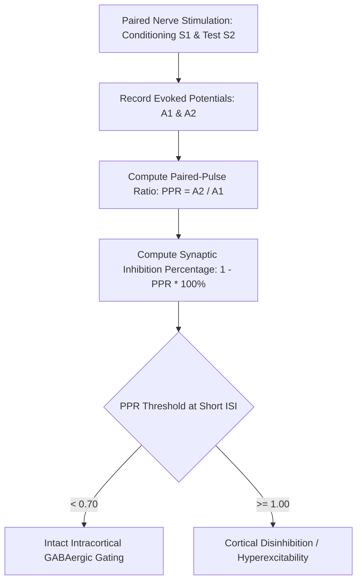

# Somatosensory Paired-Pulse Depression (PPD) Skill

[](LICENSE)
[](https://www.python.org/)
[](https://openclaw.org/)
[](https://alphapark.ai/)
[](https://modelcontextprotocol.io/)

Somatosensory Paired-Pulse Depression (PPD) and Synaptic Plasticity Evaluator based on neurophysiological evoked potential analysis.



## Features
- **Zero PIP Dependencies**: Implemented strictly with Python Standard Library (`math`, `json`, `sys`, `typing`).
- **Short-Interval Intracortical Inhibition**: Quantifies sensorimotor cortex gating and inhibitory tone.
- **Interval Sensitivity**: Analyzes both short (10-50 ms) and long (50-200 ms) recovery regimes.
- **Dual Architecture**: Native Python import and Model Context Protocol (MCP) JSON-RPC 2.0 stdio server.

## Quickstart
```bash
python example_usage.py
```

## License
Apache-2.0
